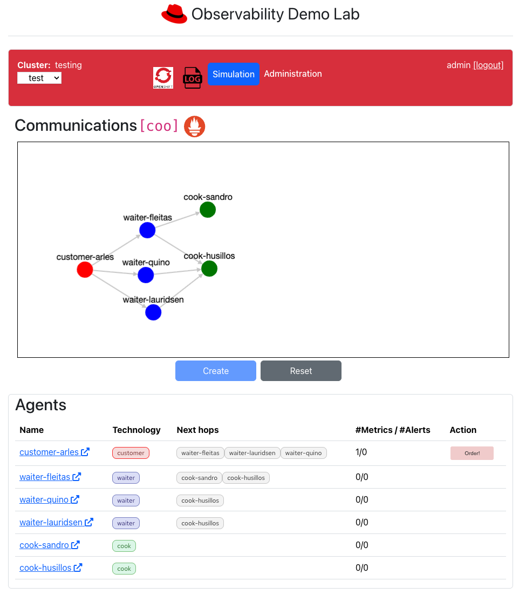
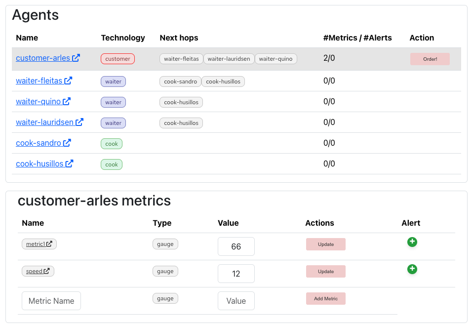
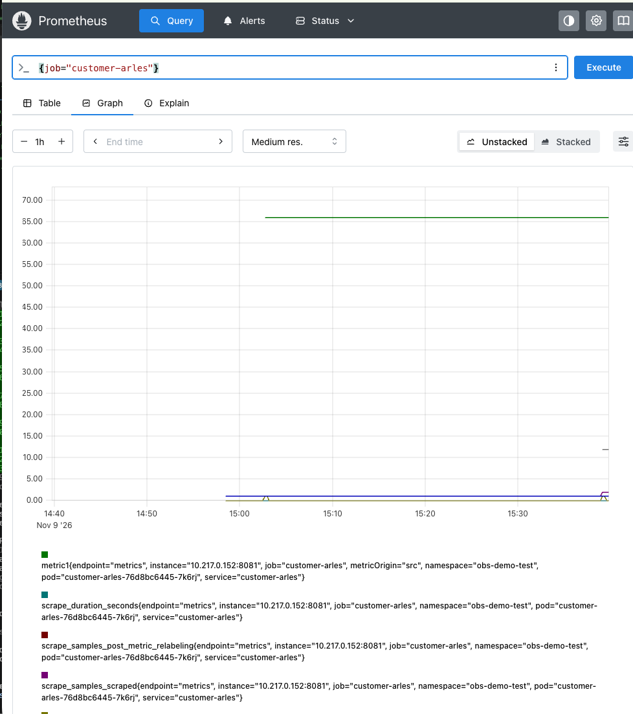
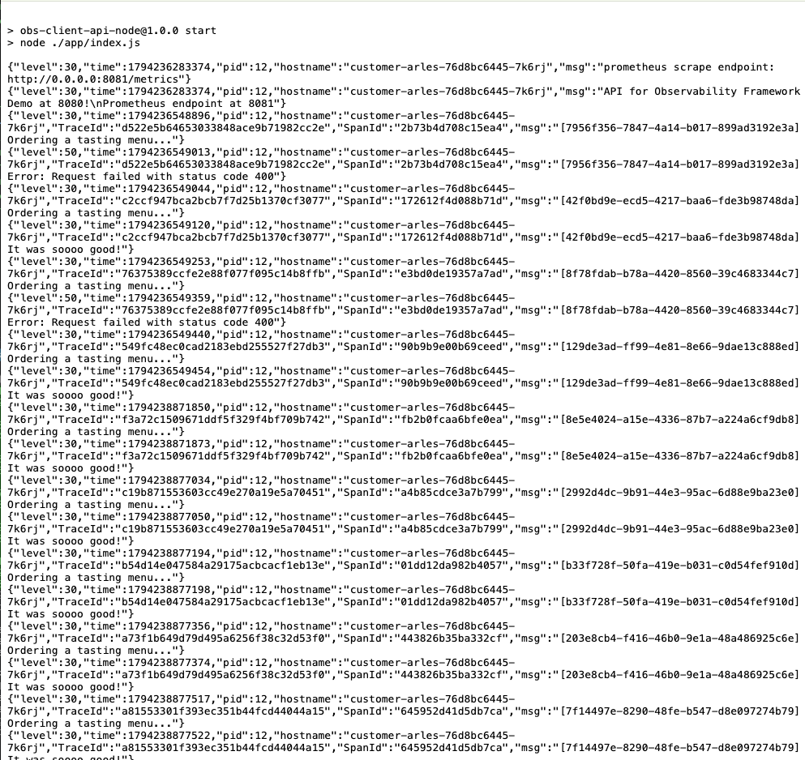
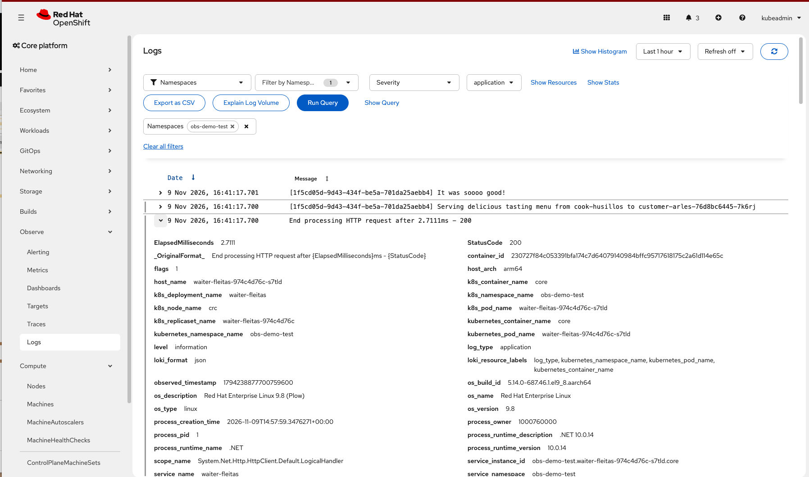
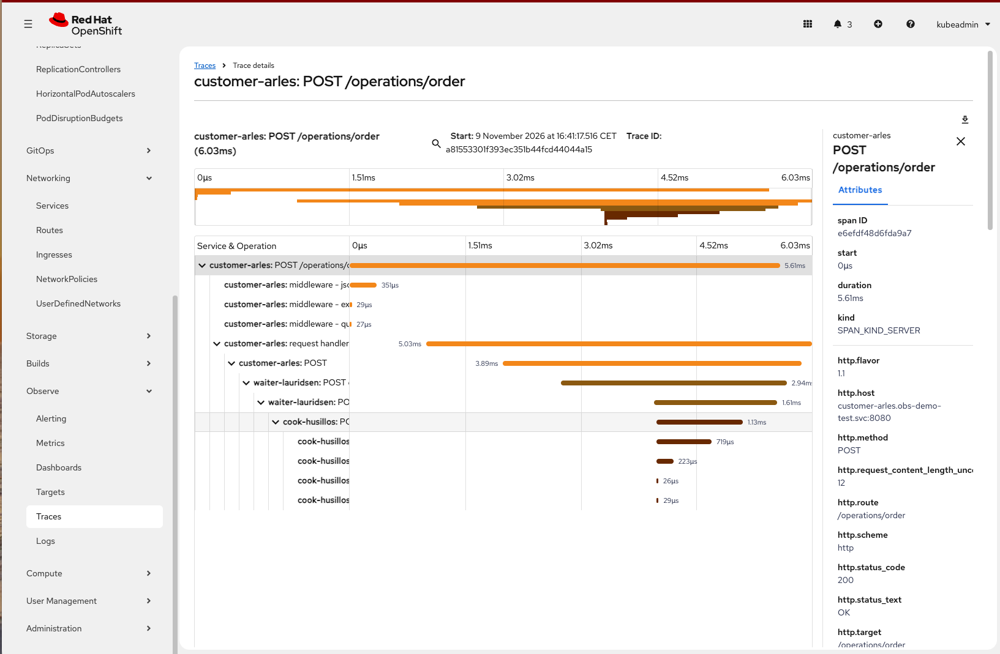

# Observability Demo Framework

A lab for showcasing Red Hat OpenShift observability (metrics, logs, traces, alerts). Users draw a
graph of agents (nodes) and communication paths (edges) in a web UI, and the framework deploys real
microservice pods into the user's namespace that talk to each other along those paths and emit
telemetry.

> Project status and planned work: see [ROADMAP.md](ROADMAP.md).

## Components

| Folder | Description |
|---|---|
| [`obs-console`](obs-console) | React + Vite UI. Graph editor (Cytoscape), simulation, metrics and alert management. Authenticates users against Keycloak. |
| [`obs-orchestrator`](obs-orchestrator) | Python FastAPI control plane. Validates Keycloak JWTs, manages users/namespaces and simulations on OpenShift through the Kubernetes Python client. |
| [`obs-clients`](obs-clients) | Agent microservices deployed as simulation pods: **Node.js** and **.NET** (Go and Java are stubs). Expose custom Prometheus metrics and forward "kick" requests to their next hops. |
| [`obs-sync-users`](obs-sync-users) | Ansible execution image used by the job that syncs app users to Keycloak. |
| [`install`](install) | Installation: Helm chart (`install/helm`) and Argo CD applications (`install/gitops`). |

### Backend bootstrap

The routers call domain services (`obs-orchestrator/app/services`), each with an OpenShift and a
mock implementation:

| Service | Owns |
|---|---|
| `TenantService` | User registry (ConfigMap) and the `sync-users` Job (Keycloak users, user namespaces) |
| `SimulationService` | Agent Deployments/Services and the stored simulation definition |
| `MonitoringService` | COO MonitoringStack, ServiceMonitors, PrometheusRules and alert definitions |
| `CapabilityService` | Cluster info for the console (Phase 4: operator and UWM detection) |
| `OperationStore` | Status of async operations |

`CLUSTER_CONNECTOR=mock` selects the mock services (JSON files, no cluster) and `AGENT_MANAGER=mock`
a fake for the calls to the agent pods.

Long-running operations (user and simulation creation/deletion) are asynchronous: the API returns
`202 Accepted` with an operation id that the UI polls at `/api/v1/operations/{id}`.

## Installation (OpenShift)

The supported installation is GitOps-based, as three Argo CD Applications. Validated end to end on
a fresh CRC (8 CPUs, 24 GB RAM, 120 GB disk, cluster monitoring enabled).

0. **Prerequisite: OpenShift GitOps operator.**

   ```bash
   cat <<EOF | oc apply -f -
   apiVersion: v1
   kind: Namespace
   metadata: {name: openshift-gitops-operator}
   ---
   apiVersion: operators.coreos.com/v1
   kind: OperatorGroup
   metadata: {name: openshift-gitops-operator, namespace: openshift-gitops-operator}
   spec: {upgradeStrategy: Default}
   ---
   apiVersion: operators.coreos.com/v1alpha1
   kind: Subscription
   metadata: {name: openshift-gitops-operator, namespace: openshift-gitops-operator}
   spec: {channel: latest, name: openshift-gitops-operator, source: redhat-operators, sourceNamespace: openshift-marketplace}
   EOF
   ```

1. **Foundations and application** (`observability-lab-base`). The Helm chart in `install/helm`
   installs the Red Hat build of Keycloak and Cluster Observability operators, Keycloak with its
   realm and generated secrets, builds the images in-cluster and deploys the app, in Argo CD sync
   waves 0-4 (5-10 minutes):

   ```bash
   oc apply -f install/gitops/base/observability-lab-base.yaml
   ```

   Log in at `https://obs-console-obs-demo.<apps-domain>` as `admin` (password in Secret
   `obs-demo-admin-creds`, namespace `obs-demo`).

2. **Operators for logging and tracing** (`observability-lab-operators`, cluster admin). Loki, Tempo
   and Red Hat build of OpenTelemetry operators, plus the RBAC that lets the Argo CD controller
   manage their custom resources:

   ```bash
   oc apply -f install/gitops/operators/observability-lab-operators.yaml
   ```

3. **Logging and tracing stack** (`observability-lab-otel`). MinIO, LokiStack, TempoStack,
   OpenTelemetry Collector and Instrumentation, console UI plugins. Can be applied right after step
   2; it retries until the operator CRDs exist:

   ```bash
   oc apply -f install/gitops/opentelemetry/observability-lab-otel.yaml
   ```

   Argo CD has no health check for LokiStack, so check its `Ready` condition directly:
   `oc get lokistack loki -n obs-loki -o jsonpath='{.status.conditions[?(@.type=="Ready")].status}'`.

> **Known limitations.** The LokiStack StorageClass is hardcoded for CRC
> (`crc-csi-hostpath-provisioner`); per-platform overlays are on the roadmap. User workload
> monitoring is not enabled by the installation, so `user-workload` simulations show no metrics
> unless it is enabled in `cluster-monitoring-config`.

Main chart values (`install/helm/values.yaml`):

| Value | Default | Purpose |
|---|---|---|
| `applicationNamespace` | `obs-demo` | Namespace for the app |
| `idpNamespace` | `obs-idp` | Namespace for Keycloak |
| `images.registry` | _(empty)_ | Registry for app images. Empty means the in-cluster registry (`image-registry.openshift-image-registry.svc:5000/<applicationNamespace>`). Set it, e.g. `quay.io/<org>`, to use pre-built images. |
| `images.{frontend,backend}.tag` | `latest` | Image tags |

> The frontend image currently embeds the API and Keycloak URLs at build time, which is why images
> are built inside the cluster. Making it runtime-configurable is on the roadmap.

## Local development

See [`obs-orchestrator/scripts/DEVELOPMENT.md`](obs-orchestrator/scripts/DEVELOPMENT.md) to run the UI and API
locally against a CRC cluster with a local Keycloak.

Tests:

```bash
# Backend (Python 3.12+): unit + API tests against the mock connectors, no cluster needed
cd obs-orchestrator && pip install -r requirements-dev.txt && python -m pytest --cov=app

# Frontend (Vitest + React Testing Library)
cd obs-console && npm ci && npm test

# Node.js client
cd obs-clients/obs-client-api-node && npm install && npm test
```

CI (`.github/workflows/ci.yaml`) lints and renders the Helm chart, runs the tests above (with a
backend coverage floor), builds the frontend and builds the .NET client. Open work is tracked in
[ROADMAP.md](ROADMAP.md).

### Upgrading images on a cluster

Images come from the chart's BuildConfigs in the app namespace (`obs-orchestrator`, `obs-console`,
`obs-client-node`, `obs-client-dotnet`). They build `<name>:latest` from this repository's `main`
branch, once at install time and then only when you start a build: no triggers.

1. **Build** the new image (from the repository root):

   ```bash
   # Change merged to main, or a pushed commit
   oc start-build obs-client-dotnet -n obs-demo --follow
   oc start-build obs-client-dotnet -n obs-demo --commit=<sha> --follow

   # Change committed locally only (no push needed): uploads that commit instead of the Git source
   oc start-build obs-client-dotnet -n obs-demo --from-repo=. --commit=HEAD --follow
   ```

2. **Restart** what runs the image. Pods use `:latest` and pull it again when they are recreated:

   ```bash
   # obs-orchestrator / obs-console
   oc rollout restart deployment/obs-console -n obs-demo

   # Agent clients (obs-client-node / obs-client-dotnet) run in each user's namespace
   for ns in $(oc get ns -l observability-demo-framework=users -o name | cut -d/ -f2); do
     oc rollout restart deployment -n "$ns" -l observability-demo-framework=agent
   done
   ```

   Deleting and recreating a simulation from the console also recreates its agents.

Argo CD does not interfere: builds and restarts do not change the manifests it tracks.

## Using the UI

A simulation is a small restaurant: **customers**, **waiters** and **cooks** are agent pods
connected on the canvas.

- **Model** communication paths between agents on the canvas.
- **Metrics**: create and update custom Prometheus gauges per agent.
- **Alerts**: define PrometheusRule alerts on those metrics.
- **Order**: a customer orders a tasting menu. The order goes to an available waiter, who passes
  it to a cook. Cooks sometimes "go crazy" (about 1 in 5 orders fail), so a few orders give you
  errors to find in logs and traces. Each order is one distributed trace across the three agents.

Agents are named after historic players of **Málaga CF** and **CD Málaga**, a very important
requirement of the system.



### Metrics

Agent metrics in the UI, and the same metrics queried in the cluster:




### Logs

Each agent writes structured logs. Every line carries the order's request id plus the `TraceId`
and `SpanId`, so a log line can be matched to its trace. Raw pod logs of a customer after a few
orders, including a failed one:



All the simulation's logs in **Observe > Logs** in the OpenShift console, stored in Loki and
filtered by the user's namespace. The OpenTelemetry collector adds Kubernetes and service
attributes (namespace, pod, deployment, `service_name`); below, a .NET waiter's log line expanded:



### Traces

The trace of one order in **Observe > Traces** (Tempo): the customer's `POST /operations/order`,
then the waiter, then the cook:


