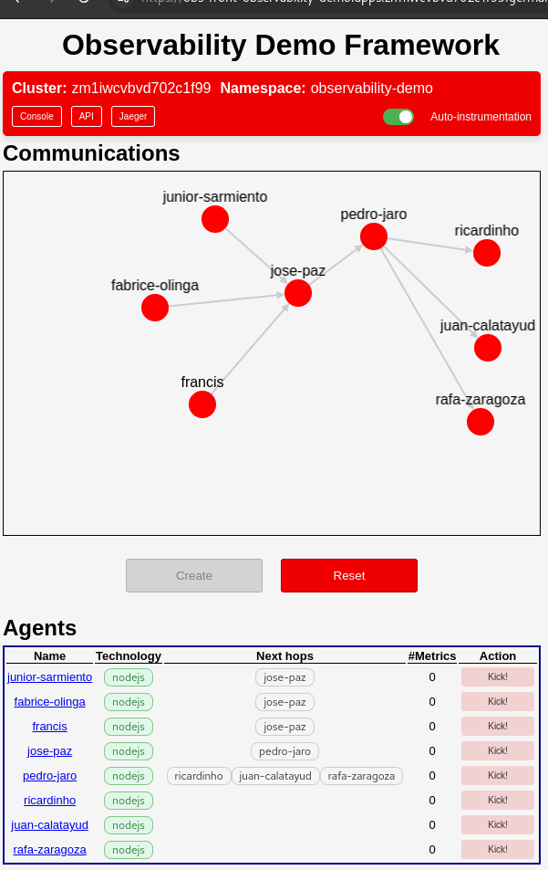
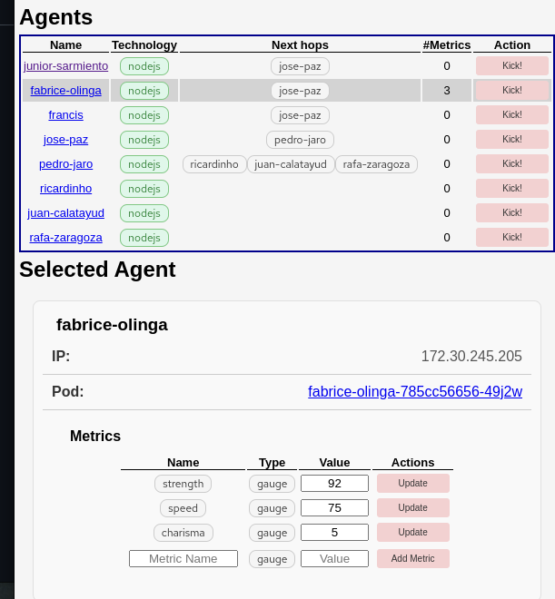

# Observability Demo Framework

A lab for showcasing Red Hat OpenShift observability (metrics, logs, traces, alerts). Users draw a
graph of agents (nodes) and communication paths (edges) in a web UI, and the framework deploys real
microservice pods into the user's namespace that talk to each other along those paths and emit
telemetry.

> Project status and planned work: see [ROADMAP.md](ROADMAP.md).

## Components

| Folder | Description |
|---|---|
| [`obs-front`](obs-front) | React + Vite UI. Graph editor (Cytoscape), simulation, metrics and alert management. Authenticates users against Keycloak. |
| [`obs-main-api`](obs-main-api) | Python FastAPI control plane. Validates Keycloak JWTs, manages users/namespaces and simulations on OpenShift through the Kubernetes Python client. |
| [`obs-clients`](obs-clients) | Agent microservices deployed as simulation pods: **Node.js** and **.NET** (Go and Java are stubs). Expose custom Prometheus metrics and forward "kick" requests to their next hops. |
| [`obs-sync-users`](obs-sync-users) | Ansible execution image used by the job that syncs app users to Keycloak. |
| [`install`](install) | Installation: Helm chart (`install/helm`) and Argo CD applications (`install/gitops`). |

### Backend bootstrap

At startup the API instantiates two implementations, selected through environment variables:

- `ClusterConnectorInterface`: `CLUSTER_CONNECTOR=mock` for an in-memory fake, otherwise OpenShift.
- `AgentManagerInterface`: `AGENT_MANAGER=mock` for a fake, otherwise calls to the agent pods.


Long-running operations (user and simulation creation/deletion) are asynchronous: the API returns
`202 Accepted` with an operation id that the UI polls at `/api/v1/operations/{id}`.

## Installation (OpenShift)

The supported installation is GitOps-based. It requires the **OpenShift GitOps** operator.

1. **Foundations and application.** The Helm chart in `install/helm` installs the operators (Red Hat
   build of Keycloak, Cluster Observability Operator), Keycloak with its realm and generated
   secrets, builds the images in-cluster and deploys the app, in Argo CD sync waves 0-4:

   ```bash
   oc apply -f install/gitops/base/observability-lab-base.yaml
   ```

2. **Logging and tracing stack (optional).** MinIO, LokiStack, TempoStack, OpenTelemetry Collector
   and the console UI plugins:

   ```bash
   oc apply -f install/gitops/opentelemetry/observability-lab-otel.yaml
   ```

Main chart values (`install/helm/values.yaml`):

| Value | Default | Purpose |
|---|---|---|
| `applicationNamespace` | `obs-demo` | Namespace for the app |
| `idpNamespace` | `obs-idp` | Namespace for Keycloak |
| `images.registry` | _(empty)_ | Registry for app images. Empty means the in-cluster registry (`image-registry.openshift-image-registry.svc:5000/<applicationNamespace>`). Set it, e.g. `quay.io/<org>`, to use pre-built images. |
| `images.{frontend,backend}.tag` | `latest` | Image tags |

> The frontend image currently embeds the API and Keycloak URLs at build time, which is why images
> are built inside the cluster. Making it runtime-configurable is on the roadmap.

## Local development

See [`obs-main-api/scripts/DEVELOPMENT.md`](obs-main-api/scripts/DEVELOPMENT.md) to run the UI and API
locally against a CRC cluster with a local Keycloak.

Tests:

```bash
# Backend (Python 3.12+), runs against the mock connectors
cd obs-main-api && pip install -r requirements-dev.txt && python -m pytest tests

# Node.js client
cd obs-clients/obs-client-api-node && npm install && npm test
```

CI (`.github/workflows/ci.yaml`) lints and renders the Helm chart, runs the tests above, builds the
frontend and builds the .NET client.

## Using the UI

- **Model** communication paths between agents on the canvas.
- **Metrics**: create and update custom Prometheus gauges per agent.
- **Alerts**: define PrometheusRule alerts on those metrics.
- **Kick**: an agent sends a message to all its next hops with a counter (starting at `4`); each
  receiver forwards it, decrementing the counter until zero, which produces distributed traces.

Agents are named after historic players of **Málaga CF** and **CD Málaga**, a very important
requirement of the system.



Agent metrics in the UI and in the cluster:




Pod logs after a kick, and the resulting trace:


