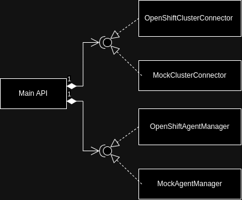
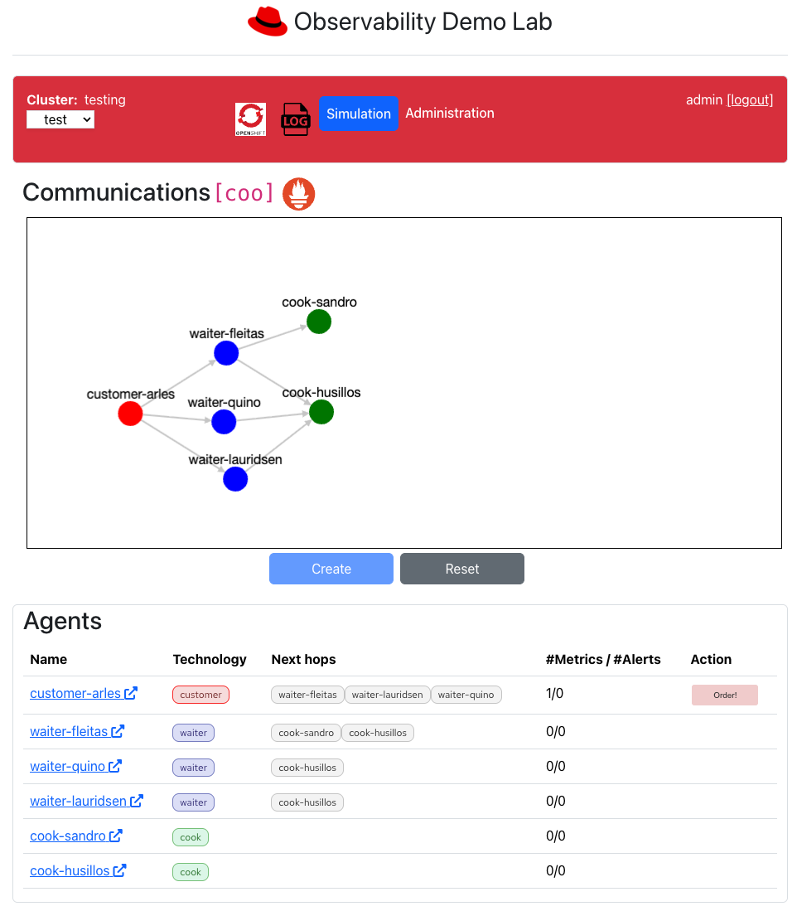
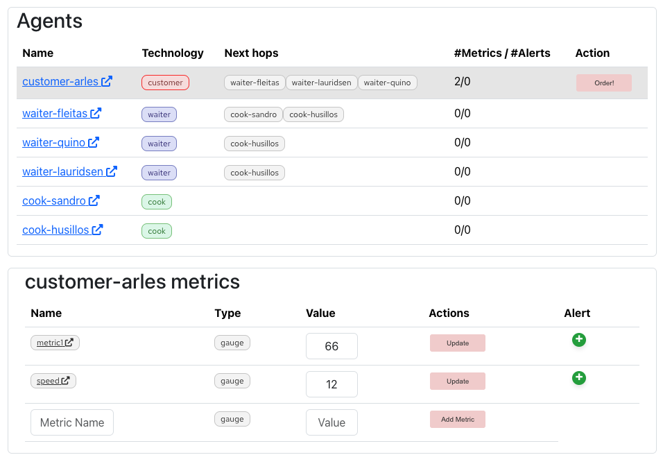
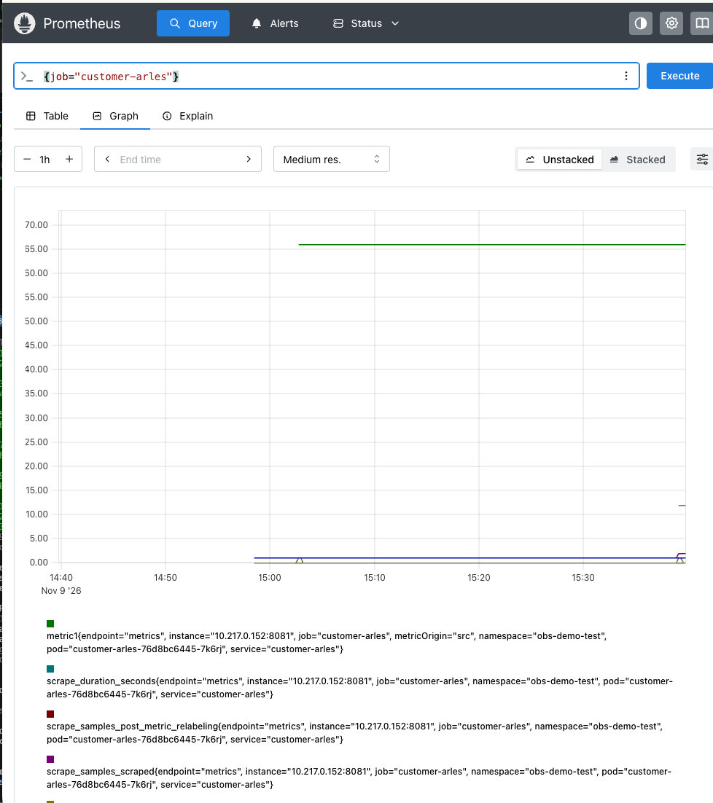
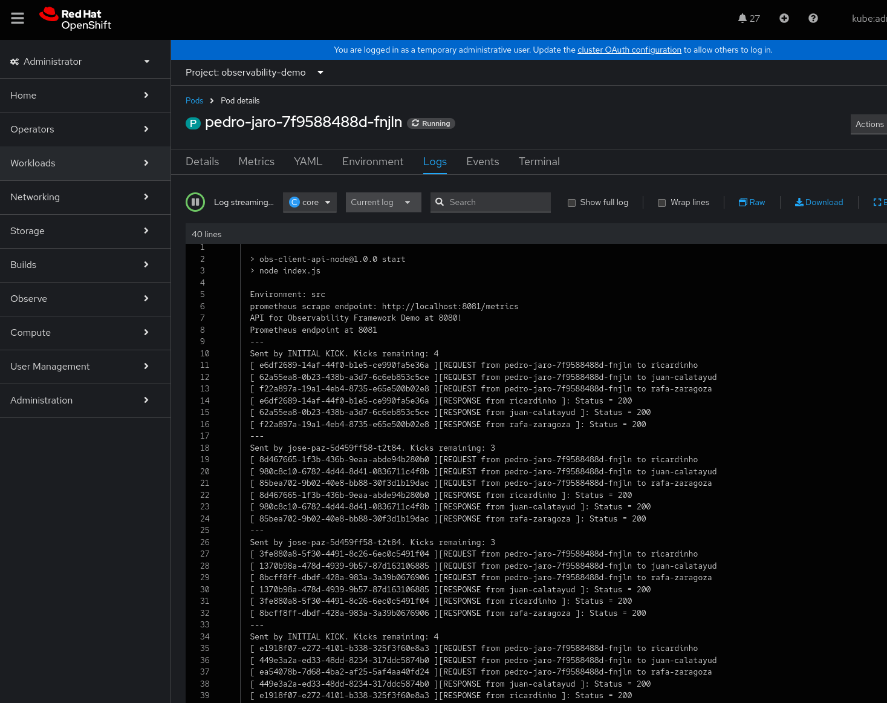
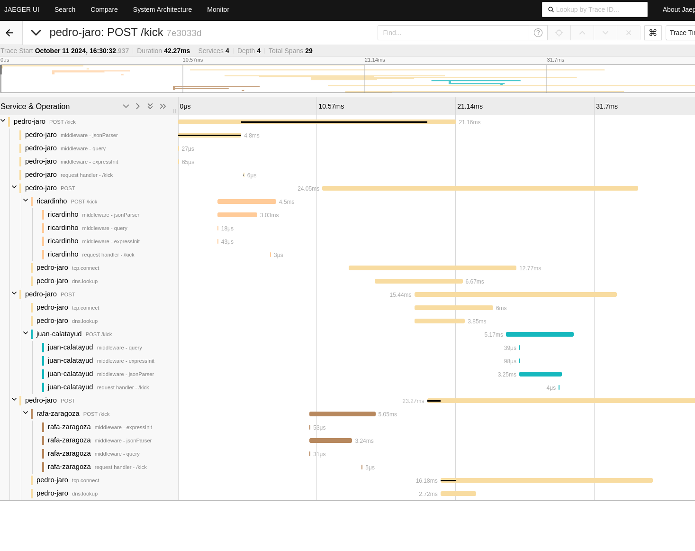

# Observability Demo Framework

A lab for showcasing Red Hat OpenShift observability (metrics, logs, traces, alerts). Users draw a
graph of agents (nodes) and communication paths (edges) in a web UI, and the framework deploys real
microservice pods into the user's namespace that talk to each other along those paths and emit
telemetry.

> Project status and planned work: see [ROADMAP.md](ROADMAP.md).

## Components

| Folder | Description |
|---|---|
| [`obs-console`](obs-console) | React + Vite UI. Graph editor (Cytoscape), simulation, metrics and alert management. Authenticates users against Keycloak. |
| [`obs-orchestrator`](obs-orchestrator) | Python FastAPI control plane. Validates Keycloak JWTs, manages users/namespaces and simulations on OpenShift through the Kubernetes Python client. |
| [`obs-clients`](obs-clients) | Agent microservices deployed as simulation pods: **Node.js** and **.NET** (Go and Java are stubs). Expose custom Prometheus metrics and forward "kick" requests to their next hops. |
| [`obs-sync-users`](obs-sync-users) | Ansible execution image used by the job that syncs app users to Keycloak. |
| [`install`](install) | Installation: Helm chart (`install/helm`) and Argo CD applications (`install/gitops`). |

### Backend bootstrap

At startup the API instantiates two implementations, selected through environment variables:

- `ClusterConnectorInterface`: `CLUSTER_CONNECTOR=mock` for an in-memory fake, otherwise OpenShift.
- `AgentManagerInterface`: `AGENT_MANAGER=mock` for a fake, otherwise calls to the agent pods.



Long-running operations (user and simulation creation/deletion) are asynchronous: the API returns
`202 Accepted` with an operation id that the UI polls at `/api/v1/operations/{id}`.

## Installation (OpenShift)

The supported installation is GitOps-based, as three Argo CD Applications. Validated end to end on
a fresh CRC (8 CPUs, 24 GB RAM, 120 GB disk, cluster monitoring enabled).

0. **Prerequisite: OpenShift GitOps operator.**

   ```bash
   cat <<EOF | oc apply -f -
   apiVersion: v1
   kind: Namespace
   metadata: {name: openshift-gitops-operator}
   ---
   apiVersion: operators.coreos.com/v1
   kind: OperatorGroup
   metadata: {name: openshift-gitops-operator, namespace: openshift-gitops-operator}
   spec: {upgradeStrategy: Default}
   ---
   apiVersion: operators.coreos.com/v1alpha1
   kind: Subscription
   metadata: {name: openshift-gitops-operator, namespace: openshift-gitops-operator}
   spec: {channel: latest, name: openshift-gitops-operator, source: redhat-operators, sourceNamespace: openshift-marketplace}
   EOF
   ```

1. **Foundations and application** (`observability-lab-base`). The Helm chart in `install/helm`
   installs the Red Hat build of Keycloak and Cluster Observability operators, Keycloak with its
   realm and generated secrets, builds the images in-cluster and deploys the app, in Argo CD sync
   waves 0-4 (5-10 minutes):

   ```bash
   oc apply -f install/gitops/base/observability-lab-base.yaml
   ```

   Log in at `https://obs-console-obs-demo.<apps-domain>` as `admin` (password in Secret
   `obs-demo-admin-creds`, namespace `obs-demo`).

2. **Operators for logging and tracing** (`observability-lab-operators`, cluster admin). Loki, Tempo
   and Red Hat build of OpenTelemetry operators, plus the RBAC that lets the Argo CD controller
   manage their custom resources:

   ```bash
   oc apply -f install/gitops/operators/observability-lab-operators.yaml
   ```

3. **Logging and tracing stack** (`observability-lab-otel`). MinIO, LokiStack, TempoStack,
   OpenTelemetry Collector and Instrumentation, console UI plugins. Can be applied right after step
   2; it retries until the operator CRDs exist:

   ```bash
   oc apply -f install/gitops/opentelemetry/observability-lab-otel.yaml
   ```

   Argo CD has no health check for LokiStack, so check its `Ready` condition directly:
   `oc get lokistack loki -n obs-loki -o jsonpath='{.status.conditions[?(@.type=="Ready")].status}'`.

> **Known limitations.** The LokiStack StorageClass is hardcoded for CRC
> (`crc-csi-hostpath-provisioner`); per-platform overlays are on the roadmap. User workload
> monitoring is not enabled by the installation, so `user-workload` simulations show no metrics
> unless it is enabled in `cluster-monitoring-config`.

Main chart values (`install/helm/values.yaml`):

| Value | Default | Purpose |
|---|---|---|
| `applicationNamespace` | `obs-demo` | Namespace for the app |
| `idpNamespace` | `obs-idp` | Namespace for Keycloak |
| `images.registry` | _(empty)_ | Registry for app images. Empty means the in-cluster registry (`image-registry.openshift-image-registry.svc:5000/<applicationNamespace>`). Set it, e.g. `quay.io/<org>`, to use pre-built images. |
| `images.{frontend,backend}.tag` | `latest` | Image tags |

> The frontend image currently embeds the API and Keycloak URLs at build time, which is why images
> are built inside the cluster. Making it runtime-configurable is on the roadmap.

## Local development

See [`obs-orchestrator/scripts/DEVELOPMENT.md`](obs-orchestrator/scripts/DEVELOPMENT.md) to run the UI and API
locally against a CRC cluster with a local Keycloak.

Tests:

```bash
# Backend (Python 3.12+): unit + API tests against the mock connectors, no cluster needed
cd obs-orchestrator && pip install -r requirements-dev.txt && python -m pytest --cov=app

# Frontend (Vitest + React Testing Library)
cd obs-console && npm ci && npm test

# Node.js client
cd obs-clients/obs-client-api-node && npm install && npm test
```

CI (`.github/workflows/ci.yaml`) lints and renders the Helm chart, runs the tests above (with a
backend coverage floor), builds the frontend and builds the .NET client. Known gaps are recorded as
expected-failure tests; see [ROADMAP.md](ROADMAP.md).

## Using the UI

- **Model** communication paths between agents on the canvas.
- **Metrics**: create and update custom Prometheus gauges per agent.
- **Alerts**: define PrometheusRule alerts on those metrics.
- **Kick**: an agent sends a message to all its next hops with a counter (starting at `4`); each
  receiver forwards it, decrementing the counter until zero, which produces distributed traces.

Agents are named after historic players of **Málaga CF** and **CD Málaga**, a very important
requirement of the system.



Agent metrics in the UI and in the cluster:




Pod logs after a kick, and the resulting trace:



